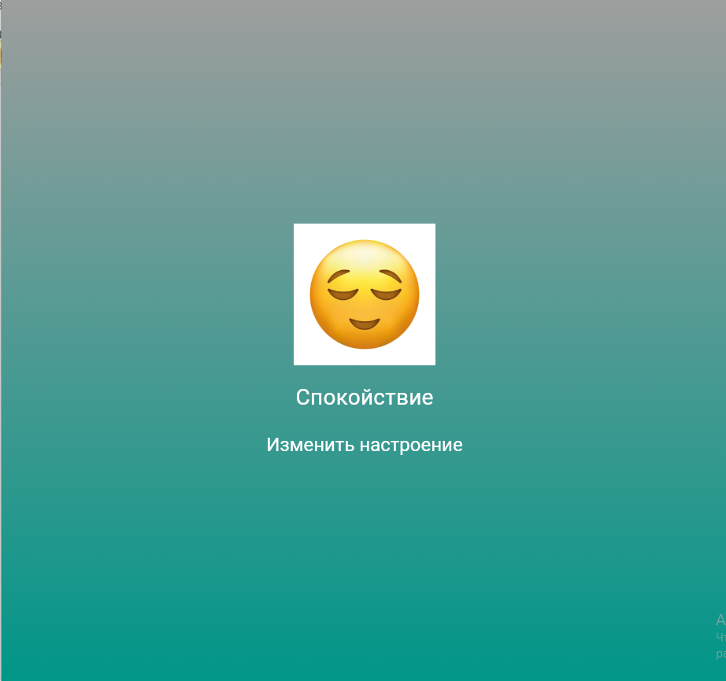

# Приложение: "Настроение дня"
По теме: смена настроения.
Приложение случайным образом отображает эмодзи и подпись текущего настроения при нажатии кнопки.

## Автор
**Фамилия, имя:** Остапова Ульяна
**Группа:** ИСП-241
**Дата сдачи:** 11.11.2026

## Стек и версия
- Flutter: 3.47.8
- Dart: 3.13.7
- Платформа: Web (Chrome)
- IDE: VS Code

## Скриншот приложения


## Структура проекта
```
lib/
|--gradient_container.dart
|--main.dart
|--mood_app.dart
|--mood_card.dart
```

`main.dart` - точка входа, запуск приложения.
`gradient_container.dart` - виджет контейнера с градиентным фоном.
`mood_app.dart` - основной экран приложения, управление текущим настроением и его изменение.
`mood_card.dart` - виджет отображения изображения и названия настроения.

## Как запустить
1. Клонировать репозиторий:
`git clone https://github.com/Uliana-Ostapova/Flutter_Lab5.git`
2. Перейти в папку проекта:
`cd emoji_ostapova`
3. Выполнить:
`flutter pub get`
4. Запустить приложение в браузере:
`flutter run -d chrome`

## Что изучено
- Создание собственных виджетов и разделение кода на отдельные файлы.

- Использование `StatefulWidget` и `setState()` для изменения состояния приложения.

- Создание и использование градиентного фона.

- Подключение изображений в проект через `assets` и файл pubspec.yaml.

- Использование `Random` для случайного выбора настроения.

## Ответы на вопросы
Вопросов в лабораторной №6 я не нашла.